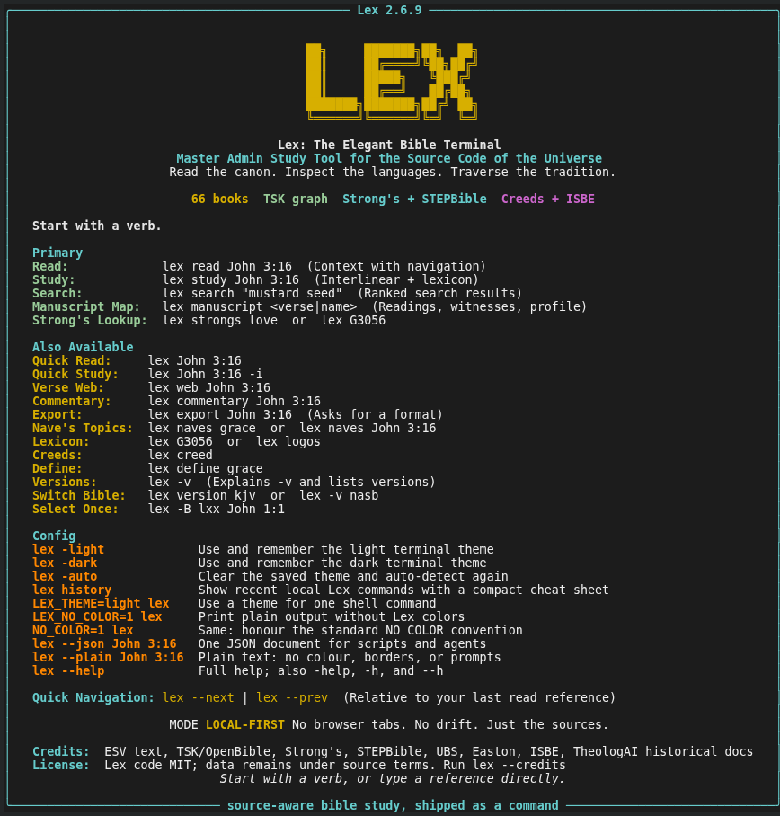
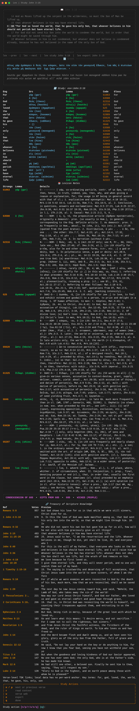
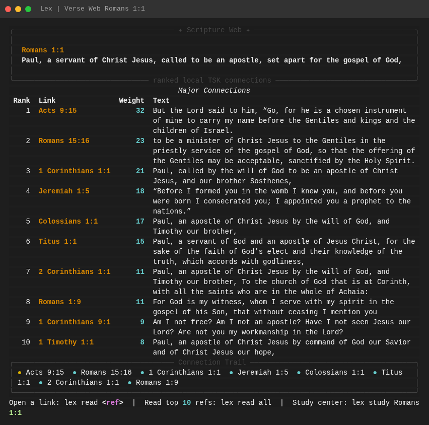
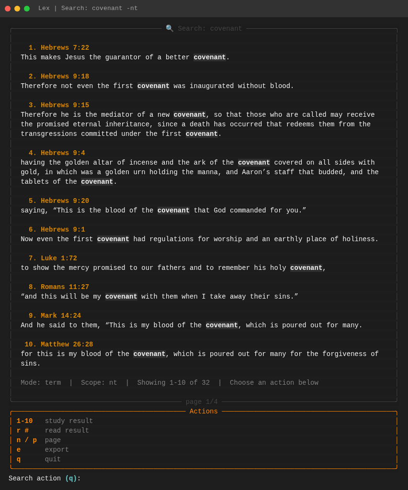
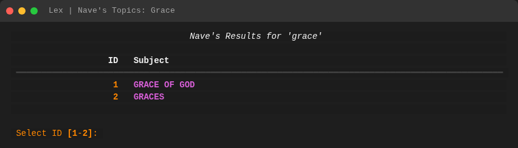

# Lex | The Elegant Bible Terminal 📖

<a href="https://scorecard.dev/viewer/?uri=github.com/elcafe7/lex"></a>
<a href="https://www.bestpractices.dev/projects/16506"></a>
<!-- virustotal-badge:start -->
<a href="security/reports/virustotal-latest.md"></a>
<br>
[Latest virus scan report (VirusTotal): v2.6.9, 2026-11-19 01:03:28 UTC](security/reports/virustotal-latest.md)
<!-- virustotal-badge:end -->
<p><strong>📖 <a href="docs/README.md">Docs</a></strong> · <a href="https://apocalypse.press/lex/docs/">apocalypse.press/lex/docs</a> · <a href="docs/get-started.md">Get started in 2 minutes</a></p>

<!-- Socket.dev badge slot: set SOCKET_URL and uncomment (security/MANUAL-STEPS.md)
[](SOCKET_URL)
-->



**Read, search, and study the Bible from your computer's terminal. Offline, fast, and free.**

## 🌱 New here? Start here

**What is Lex?** Lex is a free Bible program you use by typing. You open your computer's *terminal* (the Terminal app on a Mac, or any terminal window on Linux), type a verse like `lex John 3:16`, and the verse appears. It works with no internet connection and needs no account.

**How to start (about five minutes):**

1. **Install it.** You need [Node.js](https://nodejs.org) 18 or newer and Python 3.12 or newer on your computer. Then type `npm install -g @n8te_/lex-cli`. The first run downloads the Bible data (several hundred MB), so give it a minute. Prefer not to use npm? See [Installation](#-installation).
2. **Read a verse.** `lex John 3:16` (short names like `jn` and `rom` work too). Add `-B kjv` to read the King James Version instead.
3. **Search.** `lex search "kingdom of god"`
4. **Go deeper.** `lex study John 1:1` shows the original Greek or Hebrew word by word, with what each word means.
5. **Stuck?** Type `lex help` for a list of everything Lex can do.

Lex puts several Bible versions, interlinear study (the original Greek and Hebrew, word by word), Strong's and STEPBible word studies, the Treasury of Scripture Knowledge, and the historical creeds in one place, and it keeps working on a plane.

```bash
lex study John 1:1
lex naves grace
lex web Romans 1:1
```

Current version: `2.6.9`

## 📚 Documentation
Organised around what you want to do, with a screenshot or sample output for each:
- **On the web:** [apocalypse.press/lex/docs](https://apocalypse.press/lex/docs/)
- **On GitHub:** [docs/README.md](docs/README.md) is the index. Pages: [Get started](docs/get-started.md) · [Read a passage](docs/read-a-passage.md) · [Look up a word](docs/look-up-a-word.md) · [Search the Bible](docs/search-the-bible.md) · [Study mode](docs/study-mode.md) · [Creeds and confessions](docs/creeds-and-confessions.md) · [Use Lex with AI tools](docs/use-lex-with-ai-tools.md) · [Troubleshooting and FAQ](docs/troubleshooting-and-faq.md) · [Full command reference](docs/full-command-reference.md)
- **Everything in one file:** [lex-docs.md](https://apocalypse.press/lex/docs/lex-docs.md) (download), or [docs/lex-docs.md](docs/lex-docs.md) and [docs/lex-docs.html](docs/lex-docs.html) in this repo.


---

## 🖼️ Gallery

<p align="center">
  
  <br>
  <i>Study Mode: Interlinear source text, transliteration, and lexicon notes.</i>
</p>

---

## ⚡ Highlights

| Feature | Description |
| :--- | :--- |
| **Multi-Version** | ESV, KJV (1769 & 1611), NASB '95, Geneva 1599, Douay-Rheims 1899, Septuagint (LXX), and Vulgate. Pick one for a single command with `-B` (for example `lex -B dra John 3:16`). |
| **Unified Nave's** | Look up topics (e.g., `lex naves grace`) or find topical associations for any verse (e.g., `lex naves John 3:16`). |
| **Interlinear Study** | Source text, transliteration, and lexicon notes in a surgically precise terminal view. |
| **Verse Web** | Visualize local cross-reference connections ranked by relevance with instant previews. |
| **Historical Creeds** | The Apostles', Nicene, Athanasian and Chalcedonian creeds, shown line by line with the original Latin or Greek beside the English, plus the Westminster Confession and other major documents. |
| **Modern Aesthetics** | Auto-detecting light/dark themes with high-contrast, "Blueprint Technical" or "Studio Light" palettes. |
| **Export Engine** | Generate `.docx`/`.pdf` study packets and search results, plus read-mode PNG/PPTX and verse-slide PPTX exports. |
| **Works with AI tools** | Add `--json` and Lex prints clean, labelled results that scripts and AI assistants can read. See [Using Lex with AI tools](#-using-lex-with-ai-tools). |
| **Zero Web Dependency** | Runs against local SQLite/JSON stores. Fast, private, and works on a plane. |

---

<p align="center">
  
  <br>
  <i>Verse Web: Visualizing cross-reference connections for Romans 1:1.</i>
</p>

---

## 🚀 Installation

### Recommended: Full Git Install (most reliable)

Lex ships with several hundred MB of offline runtime data (SQLite Bibles, lexicons, cross-references, creeds). The cleanest and most reliable way to install is a full Git checkout:

```bash
git clone https://github.com/elcafe7/lex.git
cd lex
./setup.sh
```

`setup.sh` does the following:
- Creates a repo-local `.venv` (Python 3.12+ required)
- Installs Python dependencies
- Installs a `lex` wrapper into `~/.local/bin` that points at this checkout
- Puts `~/.local/bin` first in `PATH` in `~/.bashrc` (and `~/.zshrc` when zsh is your shell)
- Checks for other commands named `lex` (see below)

Local edits to `lex.py` or data files take effect immediately.

#### If `lex` runs the flex lexer instead

Linux and macOS often already have `/usr/bin/lex`: the flex lexical-analyzer
generator, a programming tool unrelated to Lex. Whichever `lex` comes first in
`PATH` wins. If `lex --version` prints something like `lex 2.6.4`, or
`lex John 3:16` complains it can't open `John`, flex is running. Check with:

```bash
type -a lex                      # first line is the one your shell runs
./scripts/check_lex_command.sh   # explains the result and the fix
```

Fixes, in order of preference:

1. Open a new terminal (or `source ~/.bashrc` / `source ~/.zshrc`) after `./setup.sh`; it puts `~/.local/bin` ahead of `/usr/bin`.
2. For other shells, put Lex's folder first yourself, e.g. fish: `fish_add_path ~/.local/bin`.
3. Install a second name that cannot clash: `./setup.sh --alias lexb`, then use `lexb John 3:16`. `lex` keeps working wherever it already does.

flex itself is untouched and still runs as `flex`.

#### Verify Git checkout data

For a Git install, the runtime data files are checked against the hashes in the
checked-in `manifest.json`:

```bash
python3 - <<'PY'
import hashlib, json, pathlib, sys
root = pathlib.Path(".")
manifest = json.loads((root / "manifest.json").read_text())
bad = []
for rel, info in manifest["assets"].items():
    path = root / rel
    if not path.exists():
        bad.append(f"missing {rel}")
        continue
    digest = hashlib.sha256(path.read_bytes()).hexdigest()
    if digest != info["hash"]:
        bad.append(f"hash mismatch {rel}")
if bad:
    print("\n".join(bad))
    sys.exit(1)
print(f"Verified {len(manifest['assets'])} runtime assets for Lex {manifest['version']}.")
PY
```

If you are installing from a GitHub release archive instead of `git clone`, use
the release checksum sidecar before unpacking:

```bash
curl -LO https://github.com/elcafe7/lex/releases/download/v2.6.9/lex-v2.6.9.tar.gz
curl -LO https://github.com/elcafe7/lex/releases/download/v2.6.9/lex-v2.6.9.tar.gz.sha256
shasum -a 256 -c lex-v2.6.9.tar.gz.sha256
```

### Alternative: npm launcher

```bash
npm install -g @n8te_/lex-cli
lex --version
```

The npm package is a small Node.js launcher. On first run it downloads the
latest Lex GitHub release archive, verifies the SHA-256 checksum, creates an
isolated Python environment, installs Python dependencies, and caches the full
offline app under your user profile. Future runs reuse that cached install.

Use the launcher when you want a one-line install:

```bash
npm install -g @n8te_/lex-cli
```

Try it after install:

```bash
lex John 3:16
lex search "kingdom of god"
lex strongs G3056
```

For launcher diagnostics:

```bash
lex --npm-version      # Node launcher version
lex --version          # Lex application version
type -a lex            # which `lex` your shell runs first
```

If `type -a lex` lists `/usr/bin/lex` (the flex lexer) before npm's global
`bin` folder (`npm prefix -g` + `/bin`), put that folder earlier in `PATH`.
See [If `lex` runs the flex lexer instead](#if-lex-runs-the-flex-lexer-instead).

### Updating

**Update both code and dependencies**
```bash
git pull
./setup.sh
```

**npm installs: update the CLI and the data**
```bash
lex update        # or: lex --update
```

With the npm launcher, `lex update` upgrades `@n8te_/lex-cli` when a newer
version is published, refreshes the offline runtime data, and prints both
versions. If it can't upgrade the CLI (for example, no write permission to the
npm prefix), it prints the exact `npm install -g ...` command to run.

**Git clones: refresh only the offline runtime data** (Bibles, lexicons, etc.)
```bash
lex update
```

In a git clone, `lex update` only updates data and won't overwrite your local
code changes. If your code is older than the data, it prints the `git pull`
command to run.

---

## ✅ Verification

Each release starting with the first one built by
[`.github/workflows/release.yml`](.github/workflows/release.yml) is built,
scanned, checksummed and attested by GitHub Actions. These files are attached
to every such release on the
[Releases page](https://github.com/elcafe7/lex/releases):

| File | What it is |
|---|---|
| `lex-v<VERSION>.tar.gz` | The release archive (what `lex-cli` downloads) |
| `lex-v<VERSION>.tar.gz.sha256` | Single-file checksum used by the npm launcher |
| `SHA256SUMS` | SHA-256 checksums for every file in the release |
| `lex-v<VERSION>.cdx.json` | CycloneDX SBOM (software bill of materials) |
| `lex-v<VERSION>-requirements.lock.txt` | Python packages resolved at build time |
| `lex-v<VERSION>-osv-scan.json` / `.md` | Dated OSV-Scanner dependency report |
| `verification.json` | Scan summary (tool, date, result, report link) for download pages |

The scan report is a dated record of the release's dependencies checked
against the [OSV database](https://osv.dev) on the day it was built. The
release workflow only publishes when the scan is clean: an advisory rated
CVSS 7.0 or above fails the release, and lower-rated ones hold it too, so a
published report always says 0 known vulnerabilities (advisories with no CVSS
score are listed as warnings). Bandit, a Python static analyzer, also checks
the source before publishing: any medium or high severity finding blocks the
release. If any check fails, nothing is published; the
findings and a suggested fix go to a "Release blocked" issue instead (details in
[docs/RELEASE_VERIFICATION.md](docs/RELEASE_VERIFICATION.md)). The OSV database
keeps growing, so to check a release against today's data, scan its SBOM
yourself:

```bash
osv-scanner scan source -L lex-v<VERSION>.cdx.json
```

**Check the checksums** (download the files you want plus `SHA256SUMS` into
one folder):

```bash
sha256sum -c --ignore-missing SHA256SUMS        # Linux
shasum -a 256 -c --ignore-missing SHA256SUMS    # macOS
```

**Check build provenance** with the [GitHub CLI](https://cli.github.com/).
This confirms the file was built from this repository by GitHub Actions:

```bash
gh attestation verify lex-v<VERSION>.tar.gz -R elcafe7/lex
```

The SBOM is also attested against the archive:

```bash
gh attestation verify lex-v<VERSION>.tar.gz -R elcafe7/lex \
  --predicate-type https://cyclonedx.org/bom
```

Releases published before the workflow existed have only the `.sha256`
sidecar.

Maintainer notes (repo settings, VirusTotal, badge data):
[docs/RELEASE_VERIFICATION.md](docs/RELEASE_VERIFICATION.md).

---

## 🔒 Security reports

Every clean release also opens a PR that adds a dated report folder,
`security/reports/<tag>_<UTC timestamp>/`, with a `summary.md` (each check,
its result, date and time in UTC) and one file per check: OSV-Scanner report,
Bandit report, SBOM, SHA256SUMS, attestation link, VirusTotal links (when
turned on) and the OpenSSF Scorecard JSON. Index of all runs, newest first:
[security/README.md](security/README.md) (machine-readable:
[security/latest.json](security/latest.json)). The VirusTotal badge at the
top of this README (and any in-repo download page) always links to the
newest published VirusTotal Markdown report:
[security/reports/virustotal-latest.md](security/reports/virustotal-latest.md).

<!-- security-reports:start -->
Latest: `v2.6.9` on 2026-11-19 01:03:28 UTC, result **pass** ([summary](security/reports/v2.6.9_20261119T010328Z/summary.md)). All runs: [security/README.md](security/README.md).
<!-- security-reports:end -->

---

## 📖 Basic Usage

### Reading
References are forgiving. Abbreviations like `jn`, `rom`, or `gn` work perfectly.

```bash
lex John 3:16        # Read a specific verse
lex Romans 8         # Read a whole chapter
lex --next           # Move to the next verse from your last position
lex history          # Show recent Lex commands
lex -B lxx Gen 1:1   # Read from the Septuagint
lex -B dra John 3:16 # Read Douay-Rheims 1899
```

### Study Mode (`-i` or `study`)
Study mode shows a verse and its surrounding verses, then the original Greek or Hebrew word by word, what each word means, related topics, and cross-references to other verses. It is the main workbench. It renders the selected-version verse context first,
then source text, interlinear rows, lexicon notes, topical associations, and TSK
cross-references. English-version OT study stays Masoretic-oriented through the
local ESV Hebrew/Aramaic interlinear packet. Septuagint and Vulgate study modes
are in progress and should remain separate selected-version paths (`-B lxx` and
`-B vulg`) as their data layers mature. LXX/Vulgate study data should not
auto-populate when studying an English Bible.

```bash
lex study John 1:1
lex John 3:16 -i
lex -B lxx Genesis 1:1 -i
```

Interactive study actions include next/previous verse, read context, verse web,
and export. Study export supports DOCX/PDF packets and a PPTX verse slide.

### Search & Scopes
Lex search is fast and scoped. You can search the whole Bible or narrow it down to specific canons.
Phrase matches rank first, likely misspellings are corrected transparently, and
book names in reference metadata do not create false results. Use `-john` to
scope to John rather than relying on the word `john`.

<p align="center">
  
</p>

```bash
lex search "kingdom of god"
lex search covenant -nt        # Search only the New Testament
lex search beast -major        # Search only Major Prophets
lex search "holy spirit" -paul  # Search only Pauline Epistles
lex search enemy -psalms       # Search only the book of Psalms
lex search wisdom -apocrypha -B dra   # Search the deuterocanonical books (Douay-Rheims)
lex search covenant --page 2 --limit 20
```

Search results include footer commands for the next page and for increasing the
number of results per page. Use explicit book/group scopes such as `-jeremiah`
or `-nt`; a bare book name in the query is treated as text to search for, not
metadata to match. Scopes work in every Bible version, using that version's own book
names (`-psalms` finds "Psalm" in the ESV and "Ps" in Geneva). `-apocrypha` (also `-deuterocanon`) and books such as `-tobit`, `-sirach` and `-1-maccabees` work in the
editions that include them. If a version doesn't have a book, Lex tells you instead of
returning nothing.

---

### Manuscript Map

Map a verse to available manuscript readings, or inspect a manuscript profile:

```bash
lex manuscript John 1:1
lex manuscript Isaiah 53:11
lex manuscript P66
lex manuscript 1Qisaa
```

Lex uses bundled or cached shards first. Missing shards are fetched individually
from Lex Web and cached under `~/.cache/lex/manuscripts/` for offline reuse.

---

## 🏛️ Reference & Theology

### Nave's Topical Bible
Lex features a unified Nave's engine. Use it to find verses by topic or topics by verse.

<p align="center">
  
</p>

```bash
lex naves faith        # Show verses tagged with "Faith"
lex naves John 3:16    # Show all Nave's topics associated with this verse
```


### Lexicons & Dictionary
Lookup Strong's numbers or English definitions directly.

```bash
lex G3056              # Lookup Greek 'Logos'
lex H7225              # Lookup Hebrew 'Reshit'
lex strongs G3056      # Entry plus ESV reverse verse usage
lex strongs G3056 --page 2 --limit 25
lex strongs G3056 --all
lex strongs            # Strong's help and options
lex define propitiation
```

### Creeds & Confessions
```bash
lex creed              # List available creeds
lex creed nicene
lex creed westminster
```

The Apostles', Nicene, Athanasian and Chalcedonian creeds show as numbered lines,
the Latin or Greek on the left and the English on the right, so you can follow
along clause by clause. On a narrow window, each original line sits above its
English.

---

## 🤖 Scripts, Agents & Pipes
Two switches make Lex friendlier to scripts, logs, and other programs. `--json` prints one
machine-readable JSON document (schema: [docs/json-output.md](docs/json-output.md); see
[Using Lex with AI tools](#-using-lex-with-ai-tools) below for a plain-words guide).
`--plain` prints the normal output as plain text. Neither ever prompts, and `--json`
never changes your saved Bible, theme, or history.

```bash
lex --json John 3:16                 # {"schema_version":1,"command":"read",...}
lex -json John 3:16                  # same; long options accept one dash or two
lex --json -B kjv strongs G3056      # -B is still a one-command override
lex --json search grace -nt --limit 5
lex --plain study John 1:1 | less    # no colour, borders, or prompts
NO_COLOR=1 lex John 3:16             # colour off, normal layout
lex --help                           # also -help, -h, and --h
```

JSON errors go to stderr as `{"error":{"code":...}}` with exit code 2 (usage),
3 (not found) or 4 (data missing). `-v` is refused in JSON mode; use `-B`.
`--help`, `-help`, `-h`, and `--h` all show the same full help. Long options
also accept one dash (`-json`, `-plain`); single-letter flags also accept two
(`--h`, `--B kjv`). Search scopes such as `-nt` and attached values such as
`-Bkjv` are unchanged.

Output width follows your terminal. In logs or CI, set `COLUMNS` (for example
`COLUMNS=100 lex John 3:16`); Lex honours it even when `TERM=dumb`. `NO_COLOR=1` (or
`LEX_NO_COLOR=1`) turns colour off.

---


## 🤖 Using Lex with AI tools
Lex can also talk to other programs, not just to you. Add `--json` (or `-json`) to almost any Lex command and it prints its answer in a form that computers read easily. That makes it a good fit for AI assistants, scripts, and spreadsheets.

### What is JSON?

JSON is a plain-text way to write down information so a computer can read it without guessing. Every piece of information has a label. The normal Lex screen is made for your eyes, with colours, boxes, and menus. `--json` output is made for programs: one line of labelled text, no colours, no boxes, no menus, and nothing to press. The verse is always under the label `text`, the reference under `ref`, the book under `book`, and so on.

`--json` never asks you a question and never changes your saved Bible, theme, or history, so it is safe to run again and again from a script.

### Try it

```sh
lex --json John 3:16 | jq .
```

That prints the one-line answer spread out so it is easy to read (the `jq .` part does the spreading; see the next section). This is the real output from Lex 2.6.9:

```json
{
  "schema_version": 1,
  "lex_version": "2.6.9",
  "command": "read",
  "edition": "esv",
  "edition_name": "English Standard Version",
  "query": "John 3:16",
  "passages": [
    {
      "query": "John 3:16",
      "ref": "John 3:16",
      "book": "John",
      "chapter": 3,
      "verse_start": 16,
      "verse_end": 16,
      "verses": [
        {
          "ref": "John 3:16",
          "key": "esv:John:3:16",
          "book": "John",
          "chapter": 3,
          "verse": 16,
          "text": "“For God so loved the world, that he gave his only Son, that whoever believes in him should not perish but have eternal life."
        }
      ]
    }
  ],
  "not_found": []
}
```

Everything about the answer is labelled: which Bible was used (`edition`), the passage, and each verse with its book, chapter, number, and `text`. Verses you asked for that Lex could not find are listed under `not_found`.

### Pick out just what you want with jq

[jq](https://jqlang.org) is a free tool that picks pieces out of JSON. The `|` symbol (a "pipe") hands the output of one command to the next one. Install jq with your package manager (for example `brew install jq` on a Mac or `sudo apt install jq` on Ubuntu).

```sh
# Just the words of the verse
lex --json John 3:16 | jq -r '.passages[0].verses[0].text'
```

Output:

```text
“For God so loved the world, that he gave his only Son, that whoever believes in him should not perish but have eternal life.
```

```sh
# A search, one result per line: reference and text
lex --json search covenant -nt --limit 3 | jq -r '.results[] | "\(.ref): \(.text)"'
```

Output:

```text
Hebrews 7:22: This makes Jesus the guarantor of a better covenant.
Hebrews 9:18: Therefore not even the first covenant was inaugurated without blood.
Hebrews 9:15: Therefore he is the mediator of a new covenant, so that those who are called may receive the promised eternal inheritance, since a death has occurred that redeems them from the transgressions committed under the first covenant.
```

```sh
# How many matches in all, and which verses are on this page
lex --json search covenant -nt --limit 2 | jq -c '{total, page_count, refs: [.results[].ref]}'
```

Output:

```text
{"total":32,"page_count":16,"refs":["Hebrews 7:22","Hebrews 9:18"]}
```

A search answer looks like this (the long list of New Testament books under `scope` is left out here with `jq 'del(.scope.books)'`; everything else is exactly what Lex printed):

```json
{
  "schema_version": 1,
  "lex_version": "2.6.9",
  "command": "search",
  "edition": "esv",
  "edition_name": "English Standard Version",
  "query": "covenant",
  "effective_query": "covenant",
  "corrections": [],
  "mode": "term",
  "scope": {
    "label": "nt"
  },
  "page": 1,
  "limit": 2,
  "page_count": 16,
  "total": 32,
  "results": [
    {
      "rank": 1,
      "ref": "Hebrews 7:22",
      "key": "esv:Hebrews:7:22",
      "book": "Hebrews",
      "chapter": 7,
      "verse": 22,
      "text": "This makes Jesus the guarantor of a better covenant."
    },
    {
      "rank": 2,
      "ref": "Hebrews 9:18",
      "key": "esv:Hebrews:9:18",
      "book": "Hebrews",
      "chapter": 9,
      "verse": 18,
      "text": "Therefore not even the first covenant was inaugurated without blood."
    }
  ]
}
```

Word studies work the same way. This picks the main details from a Strong's entry (`lex --json strongs G3056 | jq '.entries[0] | {number,language,lemma,pronunciation,brief}'`):

```json
{
  "number": "G3056",
  "language": "greek",
  "lemma": "λόγος",
  "pronunciation": "log'-os",
  "brief": "something said (including the thought); by implication, a topic (subject of discourse), also reasoning (the mental faculty) or motive; by extension, a computation; specially, (with the article in John) the Divine Expression (i.e. Christ)"
}
```

The full entry also has `brief_refs`, `definition`, and `usage` (the verses where the word appears).

### Let an AI assistant use Lex

Any AI tool that can run commands for you can use Lex: coding assistants such as Cursor or Claude Code, ChatGPT or Claude tools that have a "run a command" or terminal option, and local models (for example through Ollama or LM Studio) inside an agent app that can run commands. There is nothing to install on the AI side and no key to paste in. Lex is just a command it runs, and Lex itself needs no internet.

The simplest way is to tell the assistant how to use it. Paste something like this into its instructions (or just into the chat):

```text
You can look up Scripture with the `lex` command on this computer. Always add
--json so you get structured output. Examples:
  lex --json John 3:16                  read a verse
  lex --json -B kjv John 3:16           read it in the King James Version
  lex --json search "kingdom of god"    search the Bible
  lex --json strongs G3056              look up a Greek or Hebrew word
  lex --json study John 1:1             original-language study data
Read the "text" fields and quote them exactly. If a command fails, the error
is JSON on stderr with a "code" and a "hint"; fix the command and try again.
```

Why bother? The assistant gets the real text from your own Bible data, with the book, chapter, and verse labelled, instead of quoting from memory.

### Good to know

- `--json` works with reading (`lex --json Romans 8:28`), `study`, `strongs`, `web`, `search`, `define`, `commentary`, `naves` / `topic`, `creed`, and `history`.
- Pick a Bible for one command with `-B` (`lex --json -B dra John 3:16`). The answer's `edition` field says which one was used. `-v` (which changes your saved Bible) is refused in JSON mode.
- If something goes wrong, the error is printed to stderr as JSON and Lex exits with a number: `2` for a mistake in the command, `3` for "not found", and `4` for missing data. Success is `0`. For example, `lex --json Nowhere 9:9` exits with `3` and prints:

```json
{
  "schema_version": 1,
  "lex_version": "2.6.9",
  "error": {
    "code": "not_found",
    "message": "No verse or chapter found for: Nowhere 9:9",
    "hint": "Check the reference, or use `lex --json search <terms>` for words and `lex --json strongs <number>` for Strong's."
  }
}
```

- The full list of fields for every command is in the [JSON output reference](https://github.com/elcafe7/lex/blob/main/docs/json-output.md). New fields can be added in version 1 of the format, but existing ones will not be renamed or removed without bumping `schema_version`.
- Want a clean, no-colour version for people instead? `lex --plain study John 1:1` prints the normal output as plain text.

---

## 🎨 Themes & Customization
Lex automatically chooses a theme based on your terminal background.

```bash
lex -light             # Force Studio Light theme
lex -dark              # Force Blueprint Technical theme
lex -auto              # Revert to automatic detection
```

---

## 🗃️ Data Sources
Lex is built on the shoulders of giants. Data is sourced from:
- ESV-derived Bible database
- Douay-Rheims 1899 American Edition (eBible.org engDRA, public domain)
- CCAT LXX morphology and local Septuagint/apocrypha import
- Treasury of Scripture Knowledge (OpenBible)
- STEPBible & Strong's Lexicon data
- Easton's Bible Dictionary & ISBE
- TheologAI Creedal Database

---

## 💬 Issues and contributing

- **Questions, bugs and ideas:** open an issue in the [issue tracker](https://github.com/elcafe7/lex/issues). Add the `question` label for questions.
- **Code and docs:** pull requests against `main` are welcome. [CONTRIBUTING.md](CONTRIBUTING.md) has the steps, the checks to run, and the requirements for a change to be accepted.
- **Security problems:** please don't open a public issue. See [SECURITY.md](SECURITY.md) to report privately.

---

## 📄 License
Lex code is MIT licensed. Bible data and Lexicon content are subject to their respective upstream licenses. See [LICENSING.md](docs/LICENSING.md) for details.

---
*Created with care for the Church and the Terminal.*
