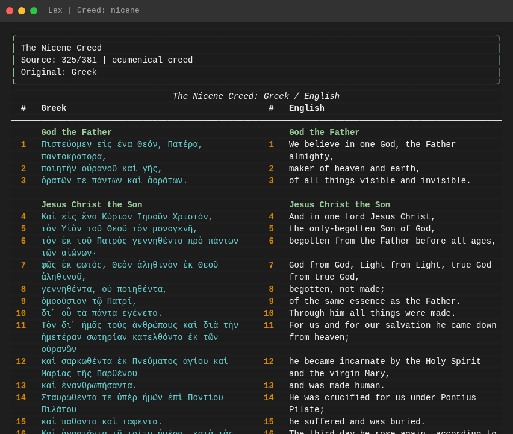

# Creeds and confessions

Read the historical statements of the faith in the original language and English, side by side.

```sh
lex creed              # list what is available
lex creed nicene
lex creed westminster
```



The Apostles', Nicene, Athanasian, and Chalcedonian creeds show as numbered lines: the Latin or Greek on the left, the English on the right, and the same number on both sides so you can follow clause by clause. On a narrow window each original line sits above its English. Longer documents such as the Westminster Confession open by name too.

While reading: `n` next section, `p` previous section, `m` menu, `q` quit.

Want a plain-text copy, for example to paste into a document? Use `lex --plain creed nicene`.

Next: [Use Lex with AI tools](use-lex-with-ai-tools.md).
