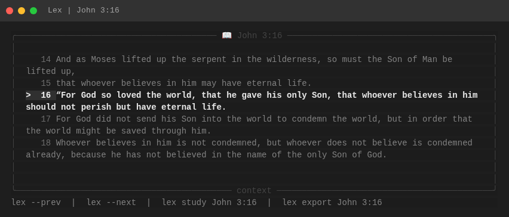

# Get started

Lex is a free Bible you use by typing. Install it once, then `lex John 3:16` shows you a verse. It takes about two minutes, plus a one-time download of the Bible data.

## What you need

- A terminal: the Terminal app on a Mac, or any terminal window on Linux.
- [Node.js](https://nodejs.org) 18 or newer, and Python 3.12 or newer. To check, type `node --version` and `python3 --version`.

## Install (about 2 minutes)

```sh
npm install -g @n8te_/lex-cli
lex --version
```

The first time you run `lex`, it downloads the Bible data (several hundred MB), checks that the download is intact, and sets itself up. After that it works with no internet connection.

Prefer to install from Git? See [Full command reference](full-command-reference.md) for the Git install, the release archive, and updating.

## Try it

```sh
lex John 3:16
```



That is the whole idea: type `lex`, then what you want to read. Short names such as `jn`, `rom`, and `gn` work too.

## Where to go next

- [Read a passage](read-a-passage.md): verses, chapters, ranges, and other Bible versions.
- [Look up a word](look-up-a-word.md): what a Greek or Hebrew word means.
- [Search the Bible](search-the-bible.md): find every verse with a word or phrase.
- [Study mode](study-mode.md): the original language, word by word.
- Stuck? Type `lex help`, or see [Troubleshooting and FAQ](troubleshooting-and-faq.md).

To get the newest version later, type `lex update`. It updates Lex and its data together, whichever way you installed it. `lex --update` and `lex -update` do exactly the same thing.
