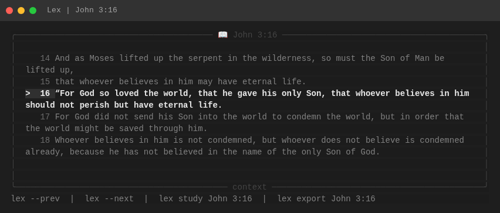
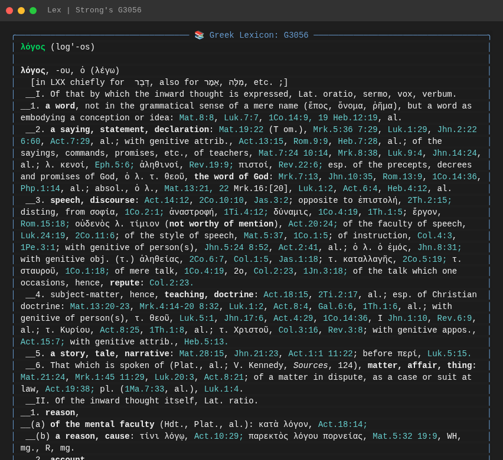
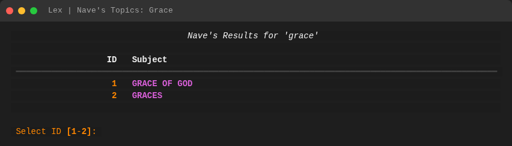
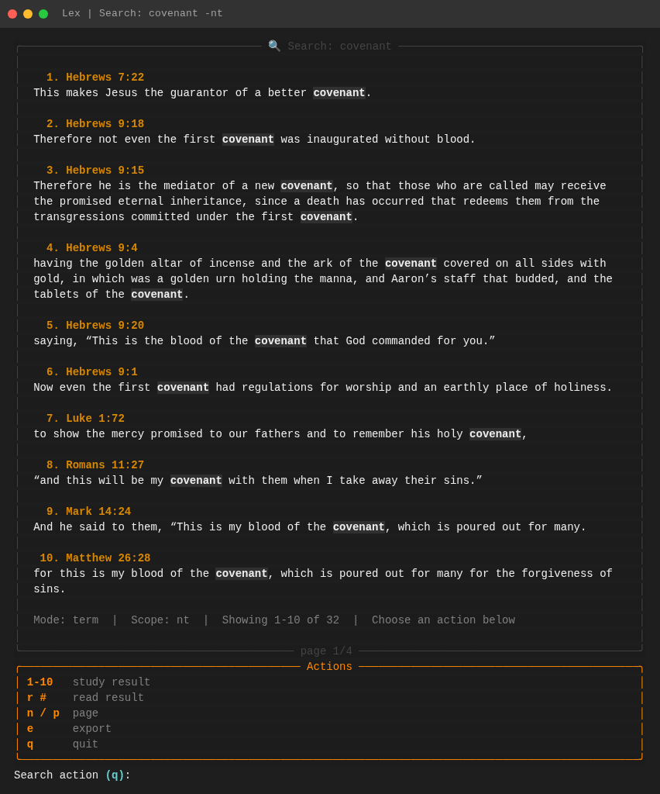
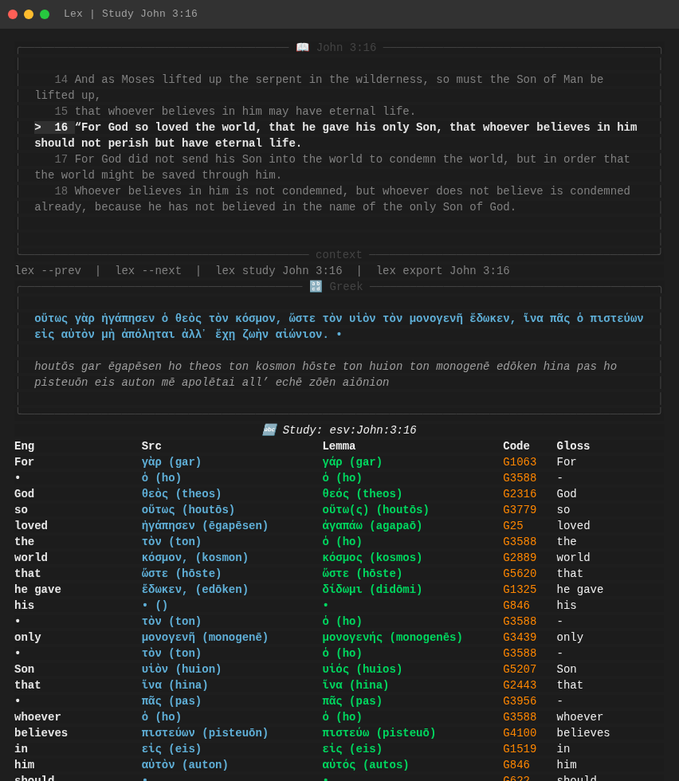
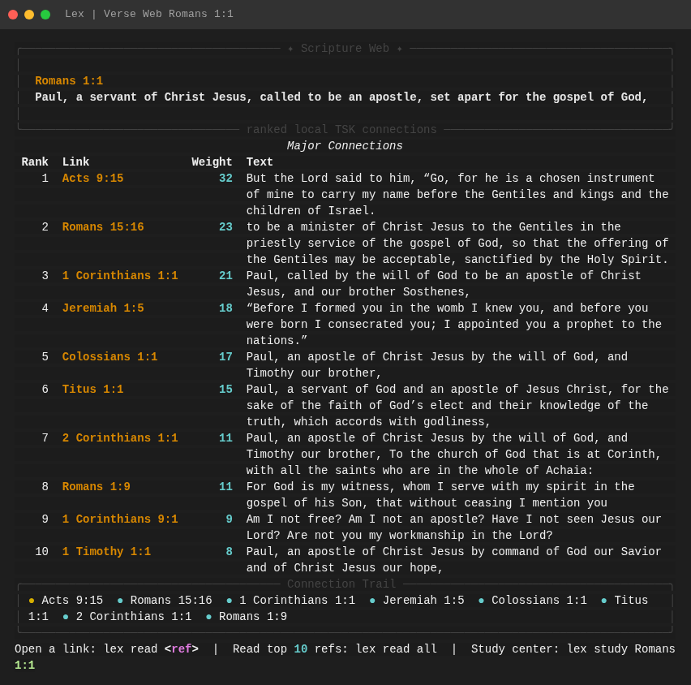
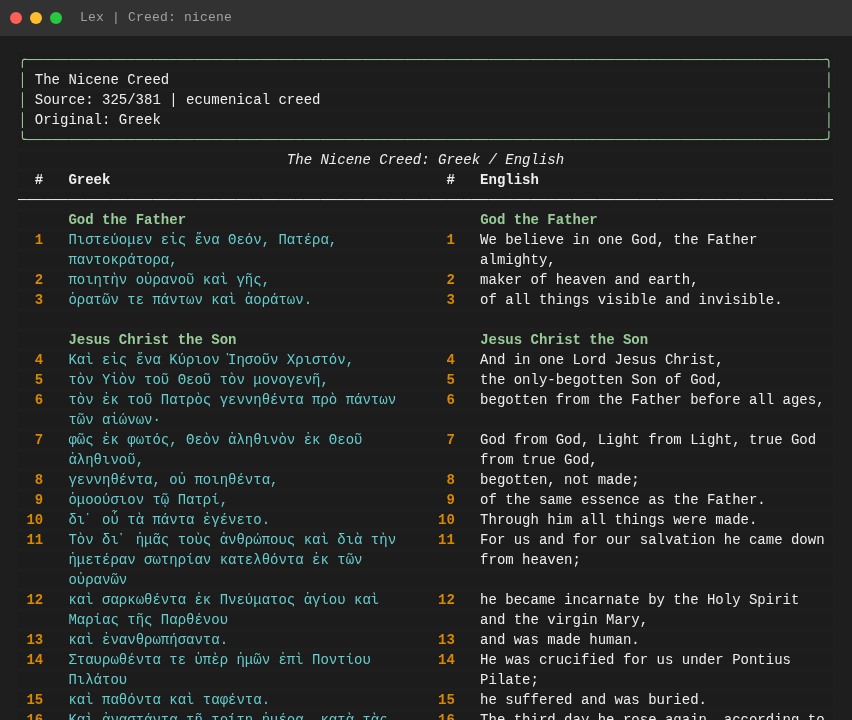

# Lex CLI Docs

*Local-first Bible study CLI* · Docs for Lex 2.6.9 · Web version: <https://apocalypse.press/lex/docs/>

Lex lets you read, search, and study the Bible from your computer's terminal, with no internet connection or account needed.

## Contents

- [Get started](#get-started)
- [Read a passage](#read-a-passage)
- [Look up a word](#look-up-a-word)
- [Search the Bible](#search-the-bible)
- [Study mode](#study-mode)
- [Creeds and confessions](#creeds-and-confessions)
- [Use Lex with AI tools](#use-lex-with-ai-tools)
- [Troubleshooting and FAQ](#troubleshooting-and-faq)
- [Full command reference](#full-command-reference)
- [For developers](#for-developers)

## Get started

Lex is a free Bible you use by typing. Install it once, then `lex John 3:16` shows you a verse. It takes about two minutes, plus a one-time download of the Bible data.

### What you need

- A terminal: the Terminal app on a Mac, or any terminal window on Linux.
- [Node.js](https://nodejs.org) 18 or newer, and Python 3.12 or newer. To check, type `node --version` and `python3 --version`.

### Install (about 2 minutes)

```sh
npm install -g @n8te_/lex-cli
lex --version
```

The first time you run `lex`, it downloads the Bible data (several hundred MB), checks that the download is intact, and sets itself up. After that it works with no internet connection.

Prefer to install from Git? See [Full command reference](#full-command-reference) for the Git install, the release archive, and updating.

### Try it

```sh
lex John 3:16
```



That is the whole idea: type `lex`, then what you want to read. Short names such as `jn`, `rom`, and `gn` work too.

### Where to go next

- [Read a passage](#read-a-passage): verses, chapters, ranges, and other Bible versions.
- [Look up a word](#look-up-a-word): what a Greek or Hebrew word means.
- [Search the Bible](#search-the-bible): find every verse with a word or phrase.
- [Study mode](#study-mode): the original language, word by word.
- Stuck? Type `lex help`, or see [Troubleshooting and FAQ](#troubleshooting-and-faq).

To get the newest version later, type `lex update`.

## Read a passage

Read any verse, chapter, or range, in any of eight Bible versions, without a browser.

```sh
lex John 3:16
lex Romans 8
lex Romans 8:28-39
lex jn 3:16
lex John 3:16, Romans 5:8
```


References are forgiving: full names, short names, and chapter-only references all work. A verse shows with the verses around it so you can see the context. To move on from where you stopped, type `lex --next` (or `lex --prev`).

### Pick a Bible version

Add `-B` to use a different version for one command:

```sh
lex -B kjv John 3:16      # King James Version
lex -B dra John 3:16      # Douay-Rheims (includes the Catholic books)
lex -B lxx Genesis 1:1    # Septuagint (Greek)
```

To change the version Lex uses every time, set a default with `-v`:

```sh
lex -v nasb
```

| ID | Bible |
|---|---|
| `esv` | English Standard Version (the default) |
| `kjv` | King James Version (Oxford 1769) |
| `kj16` | King James Version (1611) |
| `nasb` | New American Standard Bible (1995) |
| `gen` | Geneva Bible (1599) |
| `dra` | Douay-Rheims (1899 American Edition) |
| `lxx` | Septuagint (Rahlfs 1935) |
| `vulg` | Clementine Vulgate |

Next: [Look up a word](#look-up-a-word) or [Study mode](#study-mode).

## Look up a word

Find out what a Greek or Hebrew word really means, where else it appears, and what an English word is in the original.

```sh
lex strongs G3056
```

`G3056` is the Strong's number for the Greek word *logos* ("word"). Greek numbers start with `G` and Hebrew ones with `H` (for example `lex H7225`). You get the word, how it is pronounced, a definition, and the verses where it is used. Here is the top of that entry:



Don't know the number? Search by the English word:

```sh
lex strongs love
```

For long lists, page through the verses with `lex strongs G3056 --page 2 --limit 25`, or see everything with `--all`.

### Look up a topic

Nave's Topical Bible groups verses by subject, and works in reverse too:

```sh
lex naves grace          # verses about a topic
lex naves John 3:16      # topics a verse belongs to
```



### Look up a dictionary word

```sh
lex define propitiation
```

This shows entries from Easton's Bible Dictionary and the ISBE encyclopedia that are stored on your computer.

Next: [Search the Bible](#search-the-bible).

## Search the Bible

Find every verse that contains a word or phrase, ranked with the best matches first.

```sh
lex search "kingdom of god"
lex search covenant -nt
```



Exact phrases rank first, then verses that contain all your words. Likely misspellings are corrected and shown at the bottom. Each result list ends with the command for the next page.

### Search just part of the Bible

Add a dash and a name to limit the search:

```sh
lex search covenant -nt              # New Testament
lex search beast -major              # Major Prophets
lex search "holy spirit" -paul       # Paul's letters
lex search enemy -psalms             # one book
lex search beast -daniel-revelation  # a range of books
lex search wisdom -apocrypha -B dra  # the deuterocanonical books
```

Scopes work in every Bible version. Lex uses that version's own book names, so `-psalms` finds "Psalm" in the ESV and "Ps" in Geneva. If a version doesn't have that book, Lex says so instead of showing nothing. A bare book name in your search words is searched as ordinary text, so use a scope such as `-john` to search inside John.

More results per page and other pages:

```sh
lex search covenant --page 2 --limit 20
```

Want the results in a script or AI tool? See [Use Lex with AI tools](#use-lex-with-ai-tools).

## Study mode

See a verse the way a scholar would: the original Greek or Hebrew, word by word, with what each word means and where else it is used.

```sh
lex study John 1:1
```



Study mode shows, in order: the verse with the verses around it; the original-language text with a pronunciation guide; a word-by-word table (English, original, root word, Strong's number, meaning); lexicon notes; related topics; and cross-references. Press `n` and `p` for the next and previous verse, `r` for the surrounding text, `w` for the verse web, `e` to export, and `q` when you are done.

```sh
lex John 3:16 -i                 # same thing, shorter
lex study Romans 1:1 --no-animate
```

### See related verses

The verse web ranks the verses most closely connected to the one you chose, using the Treasury of Scripture Knowledge:

```sh
lex web Romans 1:1
```



### Commentary and manuscripts

```sh
lex commentary John 3:16      # Matthew Henry and John Calvin
lex manuscript John 1:1       # which ancient manuscripts read what
```

### Export your study

Save a study packet as a document or slides:

```sh
lex export "John 1:1" --mode study --format pdf
lex export "Romans 8:28-39" --mode read --format pptx
```

Exports are saved in `~/Documents/lex_exports`.

A note on languages: English Old Testament study uses the Hebrew/Aramaic text behind the ESV. Septuagint and Vulgate study (`-B lxx`, `-B vulg`) is a separate path that is still being built, and it is never mixed into English study.

Next: [Creeds and confessions](#creeds-and-confessions).

## Creeds and confessions

Read the historical statements of the faith in the original language and English, side by side.

```sh
lex creed              # list what is available
lex creed nicene
lex creed westminster
```



The Apostles', Nicene, Athanasian, and Chalcedonian creeds show as numbered lines: the Latin or Greek on the left, the English on the right, and the same number on both sides so you can follow clause by clause. On a narrow window each original line sits above its English. Longer documents such as the Westminster Confession open by name too.

While reading: `n` next section, `p` previous section, `m` menu, `q` quit.

Want a plain-text copy, for example to paste into a document? Use `lex --plain creed nicene`.

Next: [Use Lex with AI tools](#use-lex-with-ai-tools).

## Use Lex with AI tools

Lex can also talk to other programs, not just to you. Add `--json` (or `-json`) to almost any Lex command and it prints its answer in a form that computers read easily. That makes it a good fit for AI assistants, scripts, and spreadsheets.

### What is JSON?

JSON is a plain-text way to write down information so a computer can read it without guessing. Every piece of information has a label. The normal Lex screen is made for your eyes, with colours, boxes, and menus. `--json` output is made for programs: one line of labelled text, no colours, no boxes, no menus, and nothing to press. The verse is always under the label `text`, the reference under `ref`, the book under `book`, and so on.

`--json` never asks you a question and never changes your saved Bible, theme, or history, so it is safe to run again and again from a script.

### Try it

```sh
lex --json John 3:16 | jq .
```

That prints the one-line answer spread out so it is easy to read (the `jq .` part does the spreading; see the next section). This is the real output from Lex 2.6.9:

```json
{
  "schema_version": 1,
  "lex_version": "2.6.9",
  "command": "read",
  "edition": "esv",
  "edition_name": "English Standard Version",
  "query": "John 3:16",
  "passages": [
    {
      "query": "John 3:16",
      "ref": "John 3:16",
      "book": "John",
      "chapter": 3,
      "verse_start": 16,
      "verse_end": 16,
      "verses": [
        {
          "ref": "John 3:16",
          "key": "esv:John:3:16",
          "book": "John",
          "chapter": 3,
          "verse": 16,
          "text": "“For God so loved the world, that he gave his only Son, that whoever believes in him should not perish but have eternal life."
        }
      ]
    }
  ],
  "not_found": []
}
```

Everything about the answer is labelled: which Bible was used (`edition`), the passage, and each verse with its book, chapter, number, and `text`. Verses you asked for that Lex could not find are listed under `not_found`.

### Pick out just what you want with jq

[jq](https://jqlang.org) is a free tool that picks pieces out of JSON. The `|` symbol (a "pipe") hands the output of one command to the next one. Install jq with your package manager (for example `brew install jq` on a Mac or `sudo apt install jq` on Ubuntu).

```sh
# Just the words of the verse
lex --json John 3:16 | jq -r '.passages[0].verses[0].text'
```

Output:

```text
“For God so loved the world, that he gave his only Son, that whoever believes in him should not perish but have eternal life.
```

```sh
# A search, one result per line: reference and text
lex --json search covenant -nt --limit 3 | jq -r '.results[] | "\(.ref): \(.text)"'
```

Output:

```text
Hebrews 7:22: This makes Jesus the guarantor of a better covenant.
Hebrews 9:18: Therefore not even the first covenant was inaugurated without blood.
Hebrews 9:15: Therefore he is the mediator of a new covenant, so that those who are called may receive the promised eternal inheritance, since a death has occurred that redeems them from the transgressions committed under the first covenant.
```

```sh
# How many matches in all, and which verses are on this page
lex --json search covenant -nt --limit 2 | jq -c '{total, page_count, refs: [.results[].ref]}'
```

Output:

```text
{"total":32,"page_count":16,"refs":["Hebrews 7:22","Hebrews 9:18"]}
```

A search answer looks like this (the long list of New Testament books under `scope` is left out here with `jq 'del(.scope.books)'`; everything else is exactly what Lex printed):

```json
{
  "schema_version": 1,
  "lex_version": "2.6.9",
  "command": "search",
  "edition": "esv",
  "edition_name": "English Standard Version",
  "query": "covenant",
  "effective_query": "covenant",
  "corrections": [],
  "mode": "term",
  "scope": {
    "label": "nt"
  },
  "page": 1,
  "limit": 2,
  "page_count": 16,
  "total": 32,
  "results": [
    {
      "rank": 1,
      "ref": "Hebrews 7:22",
      "key": "esv:Hebrews:7:22",
      "book": "Hebrews",
      "chapter": 7,
      "verse": 22,
      "text": "This makes Jesus the guarantor of a better covenant."
    },
    {
      "rank": 2,
      "ref": "Hebrews 9:18",
      "key": "esv:Hebrews:9:18",
      "book": "Hebrews",
      "chapter": 9,
      "verse": 18,
      "text": "Therefore not even the first covenant was inaugurated without blood."
    }
  ]
}
```

Word studies work the same way. This picks the main details from a Strong's entry (`lex --json strongs G3056 | jq '.entries[0] | {number,language,lemma,pronunciation,brief}'`):

```json
{
  "number": "G3056",
  "language": "greek",
  "lemma": "λόγος",
  "pronunciation": "log'-os",
  "brief": "something said (including the thought); by implication, a topic (subject of discourse), also reasoning (the mental faculty) or motive; by extension, a computation; specially, (with the article in John) the Divine Expression (i.e. Christ)"
}
```

The full entry also has `brief_refs`, `definition`, and `usage` (the verses where the word appears).

### Let an AI assistant use Lex

Any AI tool that can run commands for you can use Lex: coding assistants such as Cursor or Claude Code, ChatGPT or Claude tools that have a "run a command" or terminal option, and local models (for example through Ollama or LM Studio) inside an agent app that can run commands. There is nothing to install on the AI side and no key to paste in. Lex is just a command it runs, and Lex itself needs no internet.

The simplest way is to tell the assistant how to use it. Paste something like this into its instructions (or just into the chat):

```text
You can look up Scripture with the `lex` command on this computer. Always add
--json so you get structured output. Examples:
  lex --json John 3:16                  read a verse
  lex --json -B kjv John 3:16           read it in the King James Version
  lex --json search "kingdom of god"    search the Bible
  lex --json strongs G3056              look up a Greek or Hebrew word
  lex --json study John 1:1             original-language study data
Read the "text" fields and quote them exactly. If a command fails, the error
is JSON on stderr with a "code" and a "hint"; fix the command and try again.
```

Why bother? The assistant gets the real text from your own Bible data, with the book, chapter, and verse labelled, instead of quoting from memory.

### Good to know

- `--json` works with reading (`lex --json Romans 8:28`), `study`, `strongs`, `web`, `search`, `define`, `commentary`, `naves` / `topic`, `creed`, and `history`.
- Pick a Bible for one command with `-B` (`lex --json -B dra John 3:16`). The answer's `edition` field says which one was used. `-v` (which changes your saved Bible) is refused in JSON mode.
- If something goes wrong, the error is printed to stderr as JSON and Lex exits with a number: `2` for a mistake in the command, `3` for "not found", and `4` for missing data. Success is `0`. For example, `lex --json Nowhere 9:9` exits with `3` and prints:

```json
{
  "schema_version": 1,
  "lex_version": "2.6.9",
  "error": {
    "code": "not_found",
    "message": "No verse or chapter found for: Nowhere 9:9",
    "hint": "Check the reference, or use `lex --json search <terms>` for words and `lex --json strongs <number>` for Strong's."
  }
}
```

- The full list of fields for every command is in the [JSON output reference](https://github.com/elcafe7/lex/blob/main/docs/json-output.md). New fields can be added in version 1 of the format, but existing ones will not be renamed or removed without bumping `schema_version`.
- Want a clean, no-colour version for people instead? `lex --plain study John 1:1` prints the normal output as plain text.

## Troubleshooting and FAQ

Quick fixes for the most common problems, and straight answers to common questions. If something is off, start by checking what your computer is running:

```sh
lex --version
type -a lex
```

### Something isn't working

| What you see | What to try |
|---|---|
| `lex` not found | Open a new terminal. For a Git install, check that `~/.local/bin` is on your `PATH` and run `./setup.sh` again. For an npm install, check that npm's global `bin` folder is on your `PATH` (`npm prefix -g` shows where). |
| `lex --version` prints something like `lex 2.6.4`, or `lex John 3:16` says it can't open `John` | Your computer already has an unrelated program called `lex` (the flex lexer) and it runs first. Type `type -a lex` to see, then open a new terminal after setup, or install a second name with `./setup.sh --alias lexb`. |
| Setup or first run fails | Check `python3 --version`: Lex needs Python 3.12 or newer. |
| Not sure which version you have | `lex --version` shows the Lex version. `lex --npm-version` shows the npm launcher's version. |
| "No reference result" | Try the full book name, such as `lex 1 Corinthians 13`. |
| Study mode says the interlinear data is not installed | Run `lex update` to download the data. |
| Output is messy in a log or CI job | Use `lex --plain ...` (no colour, boxes, or prompts) or `NO_COLOR=1`. Set `COLUMNS` to control the width; Lex honours it even when `TERM=dumb`. |
| A script or AI tool gets stuck or can't read the output | Use `lex --json ...`. It never prompts and prints one JSON document. Errors come back as JSON on stderr with exit code 2, 3, or 4. |
| A dictionary entry is missing | The local ISBE encyclopedia import is incomplete. It currently covers only Volume II (Clement to Heresh). |

### Frequently asked questions

**Does Lex need the internet?** Only to install and to update. Reading, searching, and studying all work offline.

**Is it free?** Yes. The code is MIT licensed. Bible texts and lexicons keep their own licenses; see the [licensing notes](https://github.com/elcafe7/lex/blob/main/docs/LICENSING.md).

**How do I update?** Type `lex update`. On an npm install it upgrades Lex itself and refreshes the data, and tells you both versions. On a Git checkout it refreshes the data only (run `git pull` and `./setup.sh` for the code).

**Which Bible versions are included?** Eight: ESV, KJV (1769 and 1611), NASB 1995, Geneva 1599, Douay-Rheims 1899, the Septuagint, and the Clementine Vulgate. See [Read a passage](#read-a-passage).

**Where does Lex keep my settings and history?** In small files in your home folder: `~/.lex_config.json` (default Bible and theme), `~/.lex_history`, and `~/.lex_query_history`. `lex history --clear` clears the command history.

**Can I turn the colours off or switch to a light theme?** Yes. `NO_COLOR=1 lex John 3:16` turns colour off, and `lex -light` / `lex -dark` / `lex -auto` choose a theme.

**Is there a version for the browser?** Yes: [Lex Web](https://apocalypse.press/lex-web/).

**Found a bug or have an idea?** Please [open an issue](https://github.com/elcafe7/lex/issues). Security problems go through the [private reporting steps](https://github.com/elcafe7/lex/security/policy).

## Full command reference

Every command and option, in one place. Optional flags can usually appear before or after the reference. Most commands show their own help when run without an argument, for example `lex search` or `lex strongs`.

### Install and update

Lex needs Python 3.12 or newer. The recommended install is a full Git checkout because Lex depends on a large local runtime data bundle.

```sh
git clone https://github.com/elcafe7/lex.git
cd lex
./setup.sh
```

`setup.sh` creates a repo-local virtual environment, installs the Python dependencies, and writes a `lex` wrapper into `~/.local/bin`. That wrapper runs the checkout's `lex.py` directly.

#### npm Launcher

For a one-line install, use the npm launcher (Node.js 18 or newer):

```sh
npm install -g @n8te_/lex-cli
lex --version
```

The npm package is a small launcher. On first run it downloads the latest Lex GitHub release, verifies its SHA-256 checksum, creates an isolated Python environment, installs the Python dependencies, and caches the full offline app under your user profile. Later runs reuse that cached install.

```sh
lex --npm-version   # Node launcher version
lex --version       # Lex application version
```

#### Release Archive

To install from a GitHub release archive instead of `git clone`, check the archive against its checksum file before unpacking:

```sh
curl -LO https://github.com/elcafe7/lex/releases/download/v2.6.9/lex-v2.6.9.tar.gz
curl -LO https://github.com/elcafe7/lex/releases/download/v2.6.9/lex-v2.6.9.tar.gz.sha256
shasum -a 256 -c lex-v2.6.9.tar.gz.sha256
```

#### Update Code

```sh
git pull
./setup.sh
```

#### Update Runtime Data

```sh
lex update
```

In a Git checkout, `lex update` only refreshes data: it syncs manifest-tracked files under `runtime-data/` and does not overwrite your code (it prints the `git pull` command if your code is older than the data). On an npm install it also upgrades `@n8te_/lex-cli` when a newer version is published, then refreshes the data and prints both versions.

### Reference syntax

References are intentionally forgiving. Full names, common abbreviations, compact references, and chapter-only references are accepted.

#### Single verse

```sh
lex John 3:16
lex jn 3:16
lex 2 jn 1:2
```

#### Chapter

```sh
lex Romans 8
lex read John 1
lex Gen 1
```

#### Verse range

```sh
lex Romans 8:28-39
lex John 3:16–18
lex John 3:16 - 18
```

#### Compact and hyphenated

```sh
lex jn3:16
lex 1-chronicles 16:34
lex song-of-solomon 2:1
```

#### Several references

```sh
lex John 3:16, Romans 5:8
lex study John 1:1, John 1:14
```

#### One-time Bible selection

```sh
lex -B kjv John 3:16
lex -B gen Genesis 1:1
lex -B lxx Genesis 1:1
lex -B dra John 3:16
```

### Commands

#### Start, Help, Credits

| Command | Purpose |
|---|---|
| `lex` | Open the main landing screen. |
| `lex help` | Show the full command map. |
| `lex --help` | Show every flag with a short description. `-help`, `-h` and `--h` do the same, also after a subcommand (`lex study --help`). |
| `lex --json <command>` | Print one JSON document for scripts and AI tools. See [Use Lex with AI tools](#use-lex-with-ai-tools). |
| `lex --plain <command>` | Print the normal output as plain text: no colour, borders, prompts, or animation. |
| `lex --version` | Print the plain application version for scripts. |
| `lex --npm-version` | Print the npm launcher version (npm installs only). |
| `lex --credits` | Show data credits and source acknowledgements. |
| `lex update` or `lex --update` | Refresh manifest-managed runtime data. |

#### Read Scripture

| Command | Purpose |
|---|---|
| `lex John 3:16` | Read a verse with nearby context. |
| `lex read John 3:16` | Explicit read command for a verse. |
| `lex Romans 8` | Read a full chapter. |
| `lex --next` | Move to the next verse or chapter from the saved history position. |
| `lex --prev` | Move to the previous verse or chapter from the saved history position. |
| `lex read all` | Read the top cross-references for the last verse you opened. |

#### History

| Command | Purpose |
|---|---|
| `lex history` | Show recent Lex commands from the local query history. |
| `lex history --limit 10` | Show a smaller number of recent commands. |
| `lex history --clear` | Clear the local query history. |
| `lex history clear` | Alternate clear form. |

#### Study

| Command | Purpose |
|---|---|
| `lex study John 1:1` | Show selected-version context, then source-language study tables, lexicon notes, topical associations, and TSK cross-references. |
| `lex John 3:16 -i` | Quick study mode using the interlinear flag. |
| `lex study Romans 1:1 --no-animate` | Disable pauses between study sections. |
| `lex study Romans 1:1 --animate` | Force pauses between study sections. |
| `lex -B lxx Genesis 1:1 -i` | Explicit LXX study path. This mode is in progress. |
| `lex -B vulg John 1:1 -i` | Explicit Vulgate study path. This mode is in progress. |

> **Note:** English-version Old Testament study is Masoretic-oriented through the local ESV Hebrew/Aramaic interlinear packet. LXX and Vulgate study data should not auto-populate while studying an English Bible.

#### Search

| Command | Purpose |
|---|---|
| `lex search israel` | Search Scripture for a word. |
| `lex search "kingdom of god"` | Search for a phrase. Exact phrases rank first, then verses containing all terms. |
| `lex search israel --page 2` | Open a specific result page. |
| `lex search israel --limit 25` | Change result count per page. |
| `lex search covenant -jeremiah` | Scope search to one book. |
| `lex search beast -daniel-revelation` | Scope search to a book range. |
| `lex search resurrection -nt` | Scope search to a canon group. |
| `lex search wisdom -apocrypha -B dra` | Search the deuterocanonical books in an edition that has them. |

Search looks at verse text only, and likely misspellings are corrected and shown in the result footer. A bare book name in the query is searched as text, so use a scope such as `-john` to search within a book.

Supported group scopes include `-ot`, `-old-testament`, `-nt`, `-new-testament`, `-law`, `-pentateuch`, `-torah`, `-history`, `-wisdom`, `-poetry`, `-major`, `-major-prophets`, `-minor`, `-minor-prophets`, `-prophets`, `-gospels`, `-epistles`, `-letters`, `-pauline`, `-general-epistles`, and `-apocrypha` / `-deuterocanon`.

Scopes resolve to the active edition's own book names (ESV "Psalm", Geneva "Ps", Vulgate "I Samuel", LXX "1 Samuel (1 Kingdoms)"). Deuterocanonical scopes such as `-tobit`, `-sirach`, and `-1-maccabees` work in editions that include those books, and any stored book works by its own name (`-laodiceans`, `-joshua-a`). `-wisdom` is the group; use `-wisdom-of-solomon` or `-wis` for the book. A scope the edition lacks is reported rather than returning nothing.

#### Verse Web

| Command | Purpose |
|---|---|
| `lex web John 3:16` | Show the verse plus ranked local cross-reference connections. |
| `lex web Romans 1:1 --limit 8` | Control the number of cross-reference rows. |

#### Topics, Lexicons, Dictionary

| Command | Purpose |
|---|---|
| `lex naves grace` | Open a Nave's Topical Bible entry. |
| `lex topic grace` | Alias for Nave's topic lookup. |
| `lex naves John 3:16` | Find topical associations for a verse. |
| `lex G3056` | Look up a Strong's Greek number. |
| `lex H7225` | Look up a Strong's Hebrew number. |
| `lex strongs G3056` | Show the lexicon entry plus reverse verse usage from the ESV interlinear index. |
| `lex strongs G3056 --page 2 --limit 25` | Page through reverse verse usage. |
| `lex strongs G3056 --all` | Show all reverse verse usage results. |
| `lex strongs love` | Search Strong's entries by English gloss. |
| `lex strongs` | Open the Strong's help page. |
| `lex define covenant` | Show local dictionary and encyclopedia entries. |

#### Commentary And Creeds

| Command | Purpose |
|---|---|
| `lex commentary John 3:16` | Show local commentary notes for a verse (Matthew Henry and John Calvin). |
| `lex commentary Romans 1` | Show local commentary notes for a chapter. |
| `lex creed` | Open the creed and confession navigator. The Apostles', Nicene, Athanasian and Chalcedonian creeds show as numbered lines, original language beside English. |
| `lex creed nicene` | Open a specific creed or confession by search term. |
| `lex creed westminster confession` | Open a longer historical document by name. |

#### Export

| Command | Purpose |
|---|---|
| `lex export "John 3:16"` | Open an interactive export menu. |
| `lex export "Romans 8:28-39" --mode read --format pptx` | Export read-mode verses to PPTX. |
| `lex export "Romans 8:28-39" --mode read --format png` | Export read-mode verses to PNG images. |
| `lex export "John 1:1" --mode study --format pdf` | Export study packet as PDF. |
| `lex export "John 1:1" --mode study --format docx` | Export study packet as DOCX. |
| `lex export "John 3:16" --mode web --format pdf` | Export verse web data as PDF. |
| `lex export "John 3:16" --mode web --format docx` | Export verse web data as DOCX. |

### Manuscript map

Map a verse to the manuscript readings and witnesses Lex knows about, or open a manuscript profile by name or Gregory-Aland number.

| Command | Purpose |
|---|---|
| `lex manuscript John 1:1` | Show available readings and witnesses for a verse. |
| `lex manuscript Isaiah 53:11` | Old Testament readings work the same way. |
| `lex manuscript P66` | Open a manuscript profile. |
| `lex manuscript 1Qisaa` | Open a Dead Sea Scrolls profile. |
| `lex manuscript John 1:1 --limit 25` | Show more rows. |

Lex uses bundled or cached manuscript data first. Missing pieces are fetched one at a time from Lex Web and cached under `~/.cache/lex/manuscripts/` for offline reuse.

### Interactive keys

| Mode | Keys |
|---|---|
| Study | `n` next verse, `p` previous verse, `r` read context, `w` verse web, `e` export, `q` done. |
| Search | `1-10` study result, `r #` read result, `n`/`p` page, `e` export, `q` quit. |
| Creeds | `n` next section, `p` previous section, `m` menu, `q` quit. |
| Read | Verse and chapter reads expose export actions in interactive terminals. |

### Exports

Lex writes exports under `~/Documents/lex_exports`. Study packets go under `~/Documents/lex_exports/studies`. The app tries to open finished files automatically and prints the path if the desktop blocks that.

| Mode | Formats | Notes |
|---|---|---|
| Read | PNG, PPTX | Use `--ratio 16:9` or `--ratio 1:1` for PNG exports. |
| Study | DOCX, PDF | Interactive study export also offers a PPTX verse slide. |
| Search | DOCX, PDF, PPTX | Exports the current result page from interactive search. |
| Verse Web | DOCX, PDF | Exports verse plus cross-reference connection data. |

### Bible versions

Lex ships eight Bible editions. The default is the ESV.

| ID | Edition |
|---|---|
| `esv` | English Standard Version |
| `kjv` | King James Version (Oxford 1769) |
| `kj16` | King James Version (1611) |
| `nasb` | New American Standard Bible (1995) |
| `gen` | Geneva Bible (1599) |
| `dra` | Douay-Rheims (1899 American Edition) |
| `lxx` | Septuagint (Rahlfs 1935) |
| `vulg` or `vulgate` | Clementine Vulgate |

`dra` includes the 73-book Catholic canon. Book names match the other English
editions; Douay names such as Tobias, Ecclesiasticus, 3 Kings, and Apocalypse
also work. Psalm numbers follow traditional DRA/Vulgate numbering (Psalm 22 is
"The Lord ruleth me"). The source is the public-domain eBible.org `engDRA` text.

| Command | Purpose |
|---|---|
| `lex -v nasb` | Set the default Bible version. It stays until you change it. |
| `lex version kjv` or `lex bible kjv` | Same as `-v`: set the default Bible version. |
| `lex -v gen John 3:16` | Set the default and read in one step. |
| `lex -B lxx Genesis 1:1` | Use a Bible version for one command only. Your default does not change. |

### Themes and output

Lex chooses a theme from explicit flags, environment variables, saved config, terminal hints, and platform appearance.

| Command | Purpose |
|---|---|
| `lex -light` | Persist Studio Light theme. |
| `lex -dark` | Persist Blueprint Technical theme. |
| `lex -auto` | Clear saved theme and return to automatic detection. |
| `LEX_THEME=dark lex John 3:16` | Override the theme for one command. |
| `NO_COLOR=1 lex John 3:16` | Turn colour off. `LEX_NO_COLOR=1` does the same. |

## For developers

Notes for people working on Lex itself. For contributing steps see [CONTRIBUTING.md](https://github.com/elcafe7/lex/blob/main/CONTRIBUTING.md).

### Backend overview

`lex.py` is the active tracked CLI. It owns argument parsing, local SQLite access, JSON loading, terminal rendering, update checks, export generation, and interactive action loops.

#### Entry Point

`main()` parses CLI flags and dispatches to `LexAgent` methods.

#### Database Wrapper

`LexDB` is a small SQLite query helper used by read, search, study, creeds, and dictionaries.

#### Runtime Agent

`LexAgent` resolves references, opens data stores, lazily loads JSON, renders output, and handles exports.

#### State

Last navigation position is stored in `~/.lex_history`. Recent command history is stored in `~/.lex_query_history`. Theme config is stored in `~/.lex_config.json`.

### Runtime data

A normal checkout resolves data under `runtime-data/`. If the runtime bundle is absent, Lex can fall back to `~/bible-lexicon-data` for local developer worktrees.

| Path | Use |
|---|---|
| `runtime-data/lexicon.db` | Legacy combined data and update sentinel. |
| `runtime-data/bible_versions/*.db` | Per-edition Bible text for read and search: `esv`, `kjv`, `kj16`, `nasb`, `gen` (Geneva 1599), `dra` (Douay-Rheims 1899), `lxx`, `vulg`. |
| `runtime-data/esv-data/data/esv/esv-interlinear.json` | ESV-backed Hebrew/Greek interlinear rows. |
| `runtime-data/esv-data/data/interlinear/strongs.json` | Interlinear Strong's metadata. |
| `runtime-data/lxx.db` | In-progress LXX morphology study data. |
| `runtime-data/cross_refs.db` | Treasury of Scripture Knowledge cross-reference graph. |
| `runtime-data/strongs.db` | Strong's lookup data. |
| `runtime-data/strongs_refs.db` | Reverse Strong's verse usage, built from the ESV interlinear data by `scripts/build_strongs_refs_db.py`. |
| `runtime-data/naves.db` | Nave's Topical Bible. |
| `runtime-data/places.db` | Place data. |
| `runtime-data/commentaries/*.db` | Matthew Henry and John Calvin commentaries. |
| `runtime-data/dictionary.db` | Dictionary entries. |
| `runtime-data/encyclopedia.db` | ISBE encyclopedia entries. |
| `runtime-data/creeds.db` | Creed/confession index rows. |
| `runtime-data/theolog-ai/data/historical-documents` | JSON fallback for full creed/confession texts. |
| `~/.cache/lex/manuscripts/` | Manuscript data fetched on demand and kept for offline reuse. |

`manifest.json` lists every runtime data file with its SHA-256 hash. `lex update` uses it to download only changed files, and the README has a short script to verify a Git checkout against it.

### Study boundaries

Study mode has an important source-tradition boundary.

- Render the selected Bible version as the context panel first.
- English Old Testament study remains Masoretic-oriented through ESV Hebrew/Aramaic interlinear data.
- LXX study is a separate, in-progress path selected explicitly with `-B lxx`.
- Vulgate study is a separate, in-progress path selected explicitly with `-B vulg`.
- Do not populate LXX or Vulgate study rows while the selected Bible is English.
- Do not fall back across source traditions by matching only book/chapter/verse suffixes.

### CLI dispatch

`main()` keeps command routing thin. Feature behavior should live on `LexAgent` methods.

| Route | Backend Method |
|---|---|
| `read` or bare reference | `display_verse()` / `render_chapter()` |
| `study` or `-i` | `display_verse(..., interlinear=True)` then `display_study()` |
| `help` | `display_command_map()` |
| `web` | `display_verse_web()` |
| `manuscript` | `display_manuscript()` |
| `commentary` | `display_commentary()` |
| `history` | `display_query_history()` |
| `search` | `display_search()` |
| `naves` / `topic` | `display_naves()` |
| `strongs` / `G####` / `H####` | `display_strongs()` or English Strong's search |
| `define` | Dictionary plus encyclopedia lookup |
| `creed` | `display_creed_navigator()` |
| `export` | `prompt_bulk_export()` or `handle_bulk_export()` |

### Verification

Minimum local checks after CLI changes:

```sh
python3 -m py_compile ./lex.py
python3 ./lex.py --version
python3 ./lex.py read John 3:16
python3 ./lex.py history --limit 5
python3 ./lex.py -B gen Genesis 1:1
python3 ./lex.py study Genesis 1:1 --no-animate
python3 ./lex.py -B lxx Genesis 1:1 -i --no-animate
python3 ./lex.py search israel --limit 2
python3 ./lex.py strongs G3056 --limit 2
python3 ./lex.py define heliodorus
```

Before changing install behavior, verify the local wrapper target:

```sh
type -a lex
head -5 ~/.local/bin/lex
```

---

© 2026 Lex CLI  
A project of [Jesus People SF](https://jesuspeoplesf.com) (a 501c3 ministry)  
and [Apocalypse Press](https://apocalypse.press)  
[Privacy](https://apocalypse.press/privacy/)
