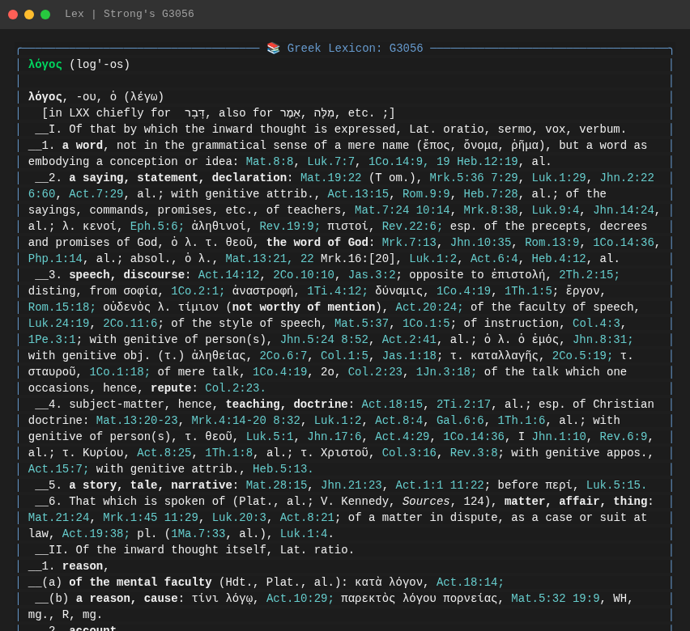
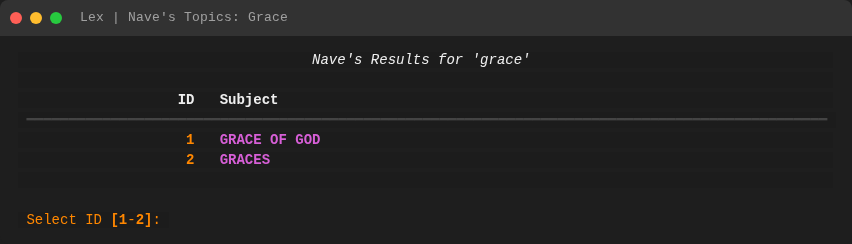

# Look up a word

Find out what a Greek or Hebrew word really means, where else it appears, and what an English word is in the original.

```sh
lex strongs G3056
```

`G3056` is the Strong's number for the Greek word *logos* ("word"). Greek numbers start with `G` and Hebrew ones with `H` (for example `lex H7225`). You get the word, how it is pronounced, a definition, and the verses where it is used. Here is the top of that entry:



Don't know the number? Search by the English word:

```sh
lex strongs love
```

For long lists, page through the verses with `lex strongs G3056 --page 2 --limit 25`, or see everything with `--all`.

## Look up a topic

Nave's Topical Bible groups verses by subject, and works in reverse too:

```sh
lex naves grace          # verses about a topic
lex naves John 3:16      # topics a verse belongs to
```



## Look up a dictionary word

```sh
lex define propitiation
```

This shows entries from Easton's Bible Dictionary and the ISBE encyclopedia that are stored on your computer.

Next: [Search the Bible](search-the-bible.md).
