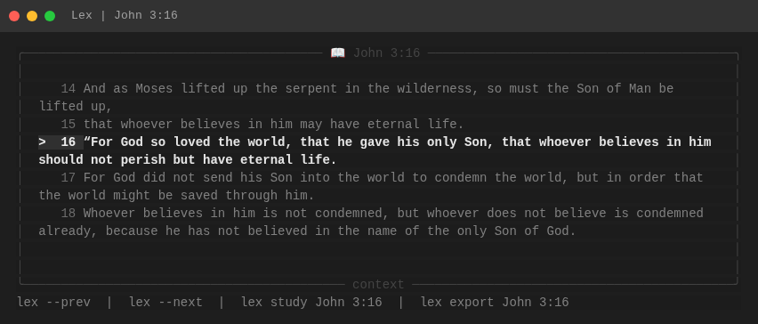

# Read a passage

Read any verse, chapter, or range, in any of eight Bible versions, without a browser.

```sh
lex John 3:16
lex Romans 8
lex Romans 8:28-39
lex jn 3:16
lex John 3:16, Romans 5:8
```



References are forgiving: full names, short names, and chapter-only references all work. A verse shows with the verses around it so you can see the context. To move on from where you stopped, type `lex --next` (or `lex --prev`).

## Pick a Bible version

Add `-B` to use a different version for one command:

```sh
lex -B kjv John 3:16      # King James Version
lex -B dra John 3:16      # Douay-Rheims (includes the Catholic books)
lex -B lxx Genesis 1:1    # Septuagint (Greek)
```

To change the version Lex uses every time, set a default with `-v`:

```sh
lex -v nasb
```

| ID | Bible |
|---|---|
| `esv` | English Standard Version (the default) |
| `kjv` | King James Version (Oxford 1769) |
| `kj16` | King James Version (1611) |
| `nasb` | New American Standard Bible (1995) |
| `gen` | Geneva Bible (1599) |
| `dra` | Douay-Rheims (1899 American Edition) |
| `lxx` | Septuagint (Rahlfs 1935) |
| `vulg` | Clementine Vulgate |

Next: [Look up a word](look-up-a-word.md) or [Study mode](study-mode.md).
