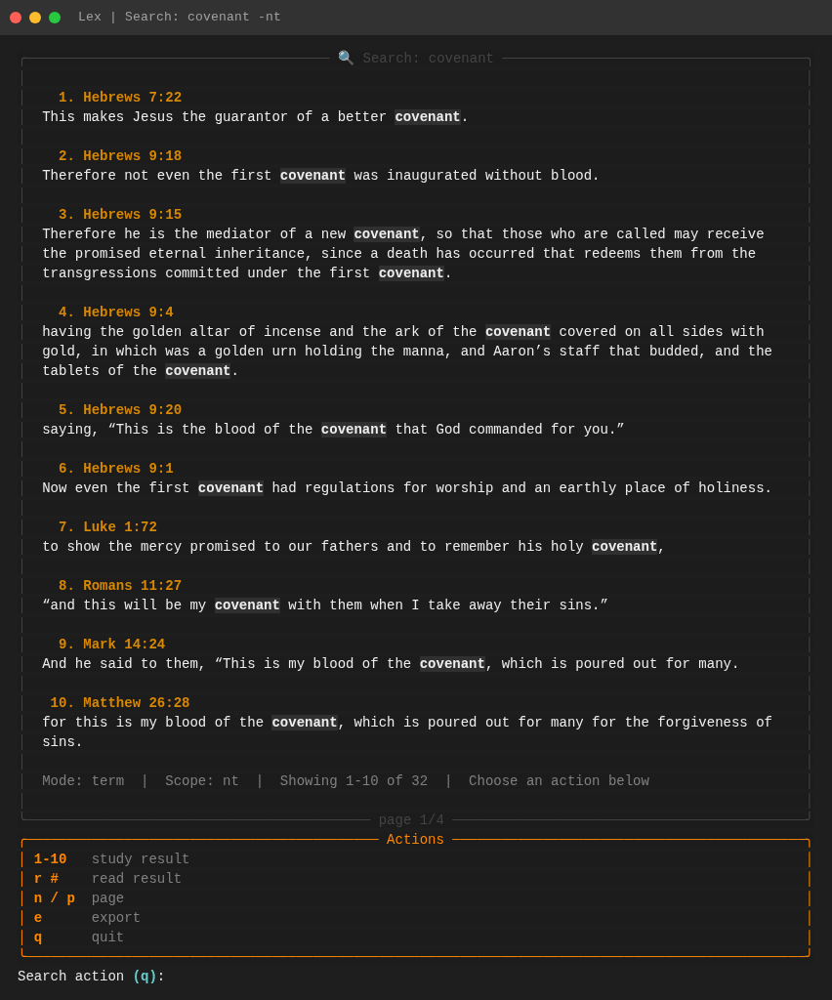

# Search the Bible

Find every verse that contains a word or phrase, ranked with the best matches first.

```sh
lex search "kingdom of god"
lex search covenant -nt
```



Exact phrases rank first, then verses that contain all your words. Likely misspellings are corrected and shown at the bottom. Each result list ends with the command for the next page.

## Search just part of the Bible

Add a dash and a name to limit the search:

```sh
lex search covenant -nt              # New Testament
lex search beast -major              # Major Prophets
lex search "holy spirit" -paul       # Paul's letters
lex search enemy -psalms             # one book
lex search beast -daniel-revelation  # a range of books
lex search wisdom -apocrypha -B dra  # the deuterocanonical books
```

Scopes work in every Bible version. Lex uses that version's own book names, so `-psalms` finds "Psalm" in the ESV and "Ps" in Geneva. If a version doesn't have that book, Lex says so instead of showing nothing. A bare book name in your search words is searched as ordinary text, so use a scope such as `-john` to search inside John.

More results per page and other pages:

```sh
lex search covenant --page 2 --limit 20
```

Want the results in a script or AI tool? See [Use Lex with AI tools](use-lex-with-ai-tools.md).
