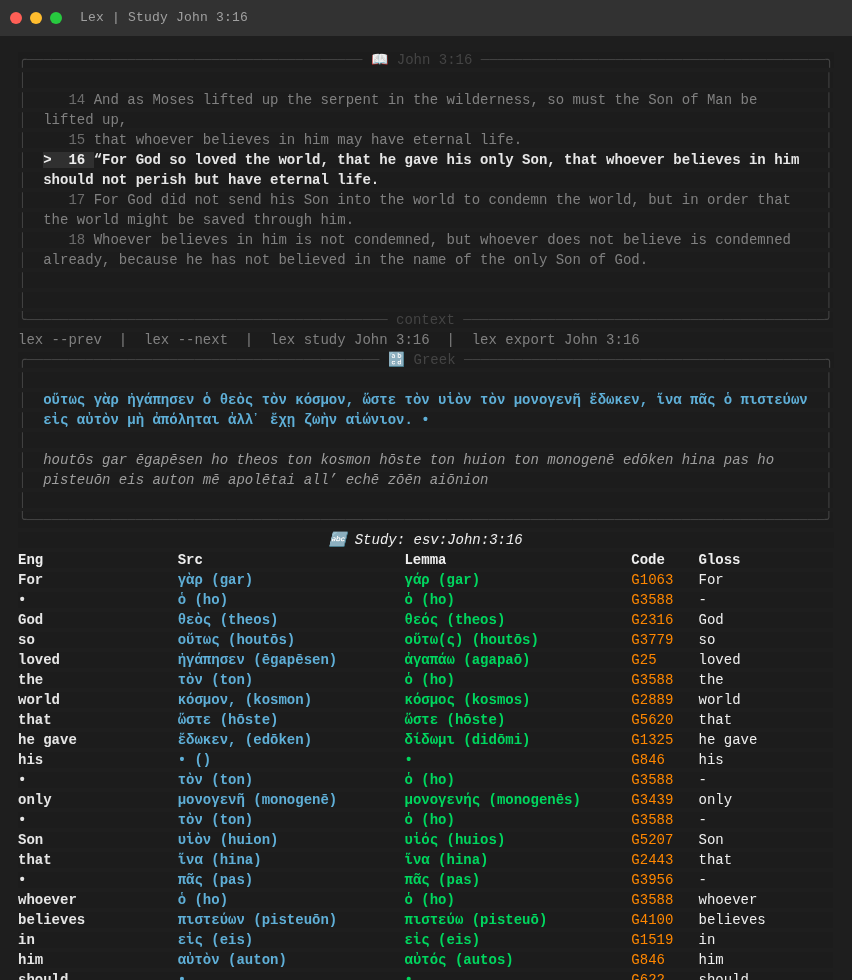
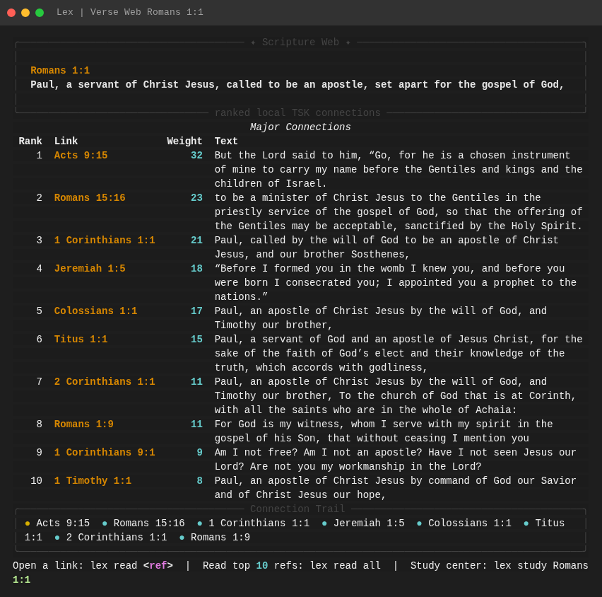

# Study mode

See a verse the way a scholar would: the original Greek or Hebrew, word by word, with what each word means and where else it is used.

```sh
lex study John 1:1
```



Study mode shows, in order: the verse with the verses around it; the original-language text with a pronunciation guide; a word-by-word table (English, original, root word, Strong's number, meaning); lexicon notes; related topics; and cross-references. Press `n` and `p` for the next and previous verse, `r` for the surrounding text, `w` for the verse web, `e` to export, and `q` when you are done.

```sh
lex John 3:16 -i                 # same thing, shorter
lex study Romans 1:1 --no-animate
```

## See related verses

The verse web ranks the verses most closely connected to the one you chose, using the Treasury of Scripture Knowledge:

```sh
lex web Romans 1:1
```



## Commentary and manuscripts

```sh
lex commentary John 3:16      # Matthew Henry and John Calvin
lex manuscript John 1:1       # which ancient manuscripts read what
```

## Export your study

Save a study packet as a document or slides:

```sh
lex export "John 1:1" --mode study --format pdf
lex export "Romans 8:28-39" --mode read --format pptx
```

Exports are saved in `~/Documents/lex_exports`.

A note on languages: English Old Testament study uses the Hebrew/Aramaic text behind the ESV. Septuagint and Vulgate study (`-B lxx`, `-B vulg`) is a separate path that is still being built, and it is never mixed into English study.

Next: [Creeds and confessions](creeds-and-confessions.md).
